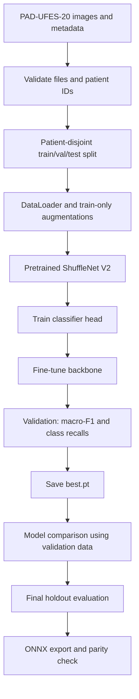

# LesioScan ML

**Deep learning research prototype for smartphone-based skin lesion image classification.**

   

> [!IMPORTANT]
> **Research and education only.** LesioScan is **not** a validated cancer screening or diagnostic tool. Predictions and softmax scores cannot determine whether a lesion is safe or malignant. Clinical use requires appropriate independent validation and oversight.

## About the project

LesioScan explores transfer learning on **PAD-UFES-20** for six lesion categories: `ACK`, `BCC`, `MEL`, `NEV`, `SCC`, `SEK`. The initial objective is to train **ShuffleNet V2** and obtain a reproducible checkpoint. **DenseNet-121** and **ViT-Small** serve as comparison architectures in later experiments.

| Component | Technology |
| --- | --- |
| Dataset | [PAD-UFES-20](https://data.mendeley.com/datasets/zr7vgbcyr2/1) |
| Deep learning | PyTorch, Torchvision, timm |
| Training | Google Colab GPU |
| Persistent files | Google Drive |
| Evaluation | Validation macro-F1, balanced accuracy, per-class recall |
| Export | ONNX |

## Machine learning pipeline



## Google Colab quick start

### 1 — Activate GPU

Open [Google Colab](https://colab.research.google.com/), create a notebook, then select **Runtime → Change runtime type → GPU** (T4 if available). Availability depends on Colab allocation.

```python
import torch
print('PyTorch:', torch.__version__)
print('CUDA available:', torch.cuda.is_available())
if torch.cuda.is_available():
    print('GPU:', torch.cuda.get_device_name(0))
```

### 2 — Mount Google Drive

```python
from google.colab import drive
from pathlib import Path

drive.mount('/content/drive')
DRIVE_ROOT = Path('/content/drive/MyDrive/LesioScan-AI')
for name in ['datasets', 'checkpoints', 'experiments', 'models']:
    (DRIVE_ROOT / name).mkdir(parents=True, exist_ok=True)
```

Keep the original dataset in `MyDrive/LesioScan-AI/datasets/PAD-UFES-20/`, and save checkpoints to `MyDrive/LesioScan-AI/checkpoints/`. Files in `/content` can disappear when Colab disconnects.

### 3 — Clone the code

```python
%cd /content
!git clone https://github.com/Liex2810/lesioscan-ml.git
%cd /content/lesioscan-ml
!ls
```

If you already cloned the repository in this runtime, skip the `git clone` line. **Use `/content/lesioscan-ml` as your working directory**, not the Google Drive folder.

### 4 — Install dependencies

Colab typically includes CUDA-enabled PyTorch. Do **not** reinstall it unless needed. Install remaining requirements:

```python
%pip install 'timm>=1,<2' 'pandas>=2.1,<3' 'numpy>=1.26,<3' \
 'scikit-learn>=1.4,<2' 'Pillow>=10,<13' 'PyYAML>=6,<7' \
 'matplotlib>=3.8,<4' 'onnx>=1.16,<2' 'onnxruntime>=1.18,<2' \
 'pytest>=8,<10' 'tqdm>=4.66,<5' 'jedi>=0.19,<1'
```

Verify CUDA again after installation.

### 5 — Prepare PAD-UFES-20

Download from [the official dataset page](https://data.mendeley.com/datasets/zr7vgbcyr2/1). Upload the original files to Google Drive, then copy or extract **images into the runtime** using this required layout:

```text
/content/lesioscan-ml/data/
├── metadata.csv
└── images/
    ├── <image from dataset>
    └── ...
```

Metadata must contain columns `img_id`, `patient_id`, and `diagnostic`. Every value in `img_id` must match an existing image filename, including its extension. Archive layouts vary; inspect the downloaded files before extracting.

Verify:

```python
from pathlib import Path
import pandas as pd
root = Path('/content/lesioscan-ml/data')
df = pd.read_csv(root / 'metadata.csv')
required = {'img_id', 'patient_id', 'diagnostic'}
assert required.issubset(df.columns), required - set(df.columns)
missing = [n for n in df.img_id.astype(str) if not (root / 'images' / n).is_file()]
print('Images referenced:', len(df), 'Missing:', len(missing))
print(df.diagnostic.value_counts())
assert not missing, 'Fix image paths before continuing.'
```

**Do not upload raw patient data or personal lesion photos to GitHub.**

### 6 — Create patient-disjoint splits

```python
%cd /content/lesioscan-ml
!python scripts/prepare.py
```

Output: `data/split.csv`. This starter uses `GroupShuffleSplit`, **not stratified group splitting**, so examine the reported class counts. It is a single train/validation/test split, **not 5-fold cross-validation**.

Persist the split:

```python
import shutil
shutil.copy2('data/split.csv', '/content/drive/MyDrive/LesioScan-AI/experiments/split.csv')
```

On future sessions, restore the same split; do not reshuffle the dataset when comparing models.

### 7 — Train ShuffleNet V2

```python
!python scripts/train.py --model shufflenet_v2_x1_0 --run shufflenet_baseline
```

The initial settings are in `configs/default.yaml`: 224×224 images, batch size 8, 5 classifier-head epochs, 20 fine-tuning epochs, AdamW, and mixed precision if CUDA is available. These are starting configurations, **not tuned best values**.

Outputs:

```text
outputs/runs/shufflenet_baseline/
├── best.pt
├── history.json
└── val_metrics.json
```

Immediately back up the run directory to Drive:

```python
shutil.copytree(
    'outputs/runs/shufflenet_baseline',
    '/content/drive/MyDrive/LesioScan-AI/checkpoints/shufflenet_baseline',
    dirs_exist_ok=True,
)
```

**Caution:** The starter saves the best model parameters but does not save the full optimizer state for seamless mid-training resumption after a Colab disconnect.

### 8 — Compare further models (optional)

```python
!python scripts/train.py --model densenet121 --run densenet_baseline
!python scripts/train.py --model vit_small_patch16_224 --run vit_baseline
```

Compare the **validation** macro-F1 and class recalls, particularly MEL, BCC, and SCC. Do not select models based on test metrics.

### 9 — One-time final test

After choosing a model and freezing your experiment protocol:

```python
!python scripts/evaluate.py --checkpoint outputs/runs/shufflenet_baseline/best.pt
```

Output: `test_metrics.json`. Replace the checkpoint path if another model is selected.

### 10 — Export ONNX

```python
!python scripts/export_onnx.py \
  --checkpoint outputs/runs/shufflenet_baseline/best.pt \
  --out deployment/model.onnx
```

Output: `deployment/model.onnx`, `deployment/labels.json`, and `deployment/preprocessing.json`. The export script verifies PyTorch-vs-ONNX numerical parity on a synthetic input. Confirm real-image parity and device latency before mobile integration.

## Dokumentasi kode

- [Arsitektur dan fungsi setiap file](docs/ARCHITECTURE.md).
- [Urutan pengerjaan proyek](docs/WORKFLOW.md).
- Seluruh instruksi Python, konfigurasi YAML, dan dependensi diberi komentar bahasa Indonesia.
- Package internal yang digunakan secara konsisten: `lesioscan`.

## Repository structure

```text
lesioscan-ml/
├── configs/default.yaml       # Training and dataset configuration
├── scripts/prepare.py         # Patient-disjoint split
├── scripts/train.py           # Transfer learning and checkpoints
├── scripts/evaluate.py        # Final holdout evaluation
├── scripts/export_onnx.py     # ONNX export and parity check
├── src/lesioscan/             # Package Python LesioScan
│   ├── config.py
│   ├── data.py
│   ├── models.py
│   ├── engine.py
│   └── metrics.py
├── data/                      # Dataset: not committed to GitHub
├── outputs/                   # Checkpoints: not committed
├── docs/
├── tests/
├── requirements.txt
└── README.md
```

**Package Python:** seluruh modul internal menggunakan nama `lesioscan` di `src/lesioscan/`.

## Engineering decisions

| Choice | Why |
| --- | --- |
| Google Colab over local CUDA | GPU training without a large installation on a 4 GB VRAM laptop; sessions are temporary. |
| GitHub + Google Drive | GitHub tracks code revisions; Drive persists datasets and checkpoints. |
| PyTorch | The existing models and training code already use Torchvision/timm. |
| Patient-level split | Reduces same-patient information leakage across splits. |
| Transfer learning | Better starting point on a relatively small dataset than training all features from random initialization. |
| Macro-F1 + per-class recall | Accuracy alone can conceal rare-class errors. |
| ONNX | Portable inference format for later app integration. |

## Research limitations and roadmap

- [x] Three backbone architectures supported
- [x] Single patient-disjoint split
- [x] Two-stage transfer learning and validation metrics
- [x] Checkpoint output and ONNX export
- [ ] CLI to predict arbitrary new images (`scripts/predict.py`)
- [ ] Patient-aware 5-fold cross-validation
- [ ] Structured external validation and error analysis
- [ ] Grad-CAM / other explainability methods
- [ ] Uncertainty assessment and model calibration
- [ ] Flutter deployment and mobile inference testing

The current code **does not yet provide measured LesioScan accuracy**, medical validation, or a finished image prediction CLI. Results from third-party repositories must not be presented as outcomes of this codebase.

## References

- [PAD-UFES-20 original dataset](https://data.mendeley.com/datasets/zr7vgbcyr2/1)
- [PAD-UFES-20 repository](https://github.com/labcin-ufes/PAD-UFES-20)
- [PyTorch](https://pytorch.org/)
- [Google Colab](https://colab.research.google.com/)
- [ONNX Runtime](https://onnxruntime.ai/)

