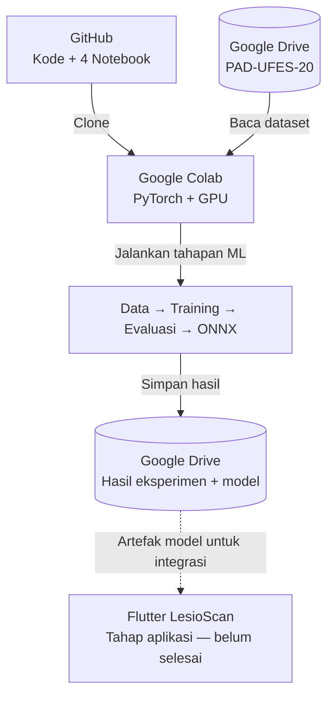
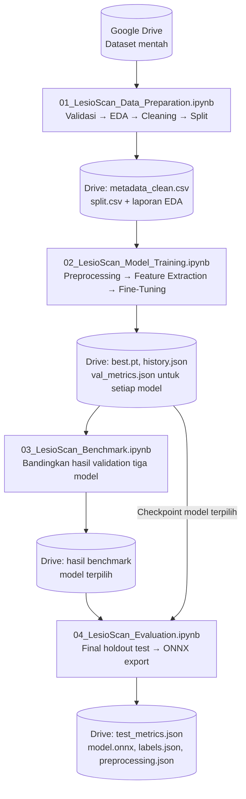
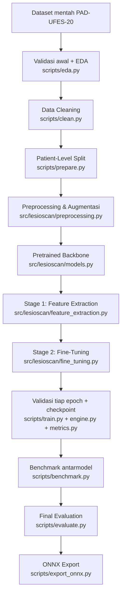

# LesioScan ML

**Pipeline klasifikasi citra lesi kulit PAD-UFES-20 berbasis PyTorch, Google Colab, dan Google Drive.**

> [!IMPORTANT]
> **Untuk penelitian dan pendidikan, bukan diagnosis medis atau alat skrining kanker.** Keluaran model tidak menggantikan pemeriksaan tenaga kesehatan. Performa pada pasien/foto di luar data penelitian belum terbukti.

## Gambaran proyek

LesioScan mempelajari klasifikasi enam kategori lesi kulit: **ACK, BCC, MEL, NEV, SCC, dan SEK**. Model utama adalah **ShuffleNet V2**, dengan **DenseNet-121** dan **ViT-Small** sebagai pembanding. Proses training menggunakan *transfer learning*: **feature extraction** (membekukan backbone) dilanjutkan **fine-tuning** (melatih backbone dengan learning rate lebih kecil).

| Komponen | Peran |
|---|---|
| **GitHub** | Source code `.py`, konfigurasi, notebook `.ipynb`, dokumentasi, pengujian |
| **Google Colab** | Menjalankan EDA, cleaning, training dengan GPU, benchmark dan evaluasi |
| **Google Drive** | Menyimpan dataset asli, hasil EDA/cleaning, split, checkpoint, laporan dan ONNX |

## 1. Arsitektur sistem



**Kedua kotak Google Drive menunjukkan layanan yang sama:** satu menjelaskan input dataset, satu menjelaskan lokasi penyimpanan hasil. Diagram **tidak** menunjukkan dataset kembali diproses dari awal.

## 2. Arsitektur empat notebook Google Colab

Notebook merupakan **pengendali proses**, sedangkan logika utama disimpan dalam `scripts/` dan `src/lesioscan/`. Notebook **tidak harus berjalan bersamaan**. Setiap notebook menyimpan output ke Drive untuk dibaca notebook berikutnya.



> [!NOTE]
> Panah antarnotebook berarti **ketergantungan input/output file di Google Drive**, bukan berbagi variabel atau satu runtime Colab. Pada notebook baru, lakukan mount Drive dan clone/pull repo lagi bila runtime baru.

### Peran dan urutan notebook

| Urutan | Notebook | Input | Proses | Output utama |
|---|---|---|---|---|
| **01** | [`01_LesioScan_Data_Preparation.ipynb`](notebooks/01_LesioScan_Data_Preparation.ipynb) | PAD-UFES-20 dari Drive | Ekstraksi, validasi, EDA, cleaning, patient-level splitting | `metadata_clean.csv`, `split.csv`, grafik dan laporan |
| **02** | [`02_LesioScan_Model_Training.ipynb`](notebooks/02_LesioScan_Model_Training.ipynb) | Gambar, metadata bersih, split | Preprocessing, feature extraction, fine-tuning; latih tiga model bila diperlukan | `best.pt`, `history.json`, `val_metrics.json` per model |
| **03** | [`03_LesioScan_Benchmark.ipynb`](notebooks/03_LesioScan_Benchmark.ipynb) | Hasil validasi setiap model | Bandingkan Macro-F1, balanced accuracy dan recall | Tabel/grafik perbandingan, pilihan model |
| **04** | [`04_LesioScan_Evaluation.ipynb`](notebooks/04_LesioScan_Evaluation.ipynb) | Model terpilih, test set yang belum dipakai untuk tuning | Evaluasi akhir, visualisasi, ekspor ONNX | `test_metrics.json`, `model.onnx`, `labels.json`, `preprocessing.json` |

**Pengaturan runtime:** notebook **01 dan 03 dapat menggunakan CPU**; notebook **02 sebaiknya menggunakan GPU**; notebook **04 dapat menggunakan GPU** bila tersedia. Setiap notebook berisi setup lingkungan sendiri. Tidak diperlukan notebook `00_Setup.ipynb` sebagai prasyarat.

## 3. Pipeline Machine Learning dan file yang bertanggung jawab



**Penting:** tahapan Stage 1 dan Stage 2 **otomatis dipanggil oleh `scripts/train.py`**, tidak dijalankan sebagai dua script terpisah. Validasi dilakukan selama kedua tahap, bukan hanya di akhir. Benchmark mengumpulkan **hasil validasi** antarmodel; test set hanya digunakan setelah model terpilih.

## 4. Struktur repository

```text
lesioscan-ml/
├── configs/
│   └── default.yaml                   # Lokasi data, label, hyperparameter
├── data/
│   └── README.md                      # Petunjuk data runtime (dataset jangan di-commit)
├── notebooks/                         # Notebook yang dijalankan di Colab
│   ├── 01_LesioScan_Data_Preparation.ipynb
│   ├── 02_LesioScan_Model_Training.ipynb
│   ├── 03_LesioScan_Benchmark.ipynb
│   └── 04_LesioScan_Evaluation.ipynb
├── scripts/                           # Titik masuk perintah (CLI)
│   ├── eda.py                         # EDA
│   ├── clean.py                       # Data cleaning
│   ├── prepare.py                     # Split berdasarkan pasien
│   ├── train.py                       # Feature extraction + fine-tuning
│   ├── plot_training.py               # Grafik training
│   ├── benchmark.py                   # Rekap perbandingan validasi
│   ├── evaluate.py                    # Evaluasi final test
│   ├── visualize_evaluation.py        # Visualisasi metrik
│   ├── export_onnx.py                 # Ekspor dan cek ONNX
│   ├── predict.py                     # Inferensi gambar (setelah model ada)
│   └── benchmark_inference.py         # Pengukuran waktu inferensi
├── src/lesioscan/                     # Implementasi fungsi yang digunakan scripts/
│   ├── config.py
│   ├── data.py
│   ├── cleaning.py
│   ├── splitting.py
│   ├── preprocessing.py
│   ├── models.py
│   ├── feature_extraction.py
│   ├── fine_tuning.py
│   ├── engine.py
│   ├── metrics.py
│   └── inference.py
├── tests/                             # Pengujian otomatis
├── docs/                              # Dokumentasi metode dan hasil
├── requirements.txt
├── pytest.ini
├── .gitignore
└── README.md
```

> Nama package yang digunakan adalah **`lesioscan`**, bukan `dermascan`. Struktur ini menjadi **target setelah versi source code dan keempat notebook terbaru di-push**. Periksa keberadaan file di branch `main` sebelum membuka tautan notebook.

## 5. Struktur Google Drive dan kontrak input/output

```text
MyDrive/LesioScan-AI/
├── datasets/
│   └── PAD-UFES-20/                  # Arsip gambar + metadata asli (input)
├── experiments/
│   ├── eda/                          # Hasil EDA notebook 01
│   ├── cleaning/                     # Laporan cleaning notebook 01
│   ├── splits/                       # metadata_clean.csv + split.csv notebook 01
│   ├── training/                     # Grafik/rekaman training notebook 02
│   ├── benchmark/                    # Perbandingan notebook 03
│   └── evaluation/                   # Evaluasi notebook 04
├── checkpoints/                       # best.pt + metrik masing-masing model
└── models/                            # ONNX + metadata model final
```

**`/content/lesioscan-ml` adalah direktori kerja sementara Colab**. Dataset disalin/diekstrak ke `data/images/`; metadata berada di `data/metadata.csv`. Karena `/content` tidak persisten, notebook harus **mencadangkan output ke Drive** dan memulihkan input pada sesi berikutnya. Jangan melakukan `git add` pada gambar pasien, checkpoint, atau data sensitif.

## 6. Cara menggunakan notebook dari GitHub

1. **Push** keempat notebook dan kode Python terbaru ke branch `main` dalam folder yang ditunjukkan di atas.
2. Buka [Google Colab](https://colab.research.google.com/) → **File → Open notebook → GitHub**, lalu cari repository `Liex2810/lesioscan-ml` dan pilih notebook **01**.
3. Jalankan **setup di awal notebook 01** untuk mount Drive, clone/pull repo dan memeriksa dataset. Ikuti cell hingga hasil cleaning dan splitting tersimpan di Drive.
4. Buka notebook **02** pada sesi berikutnya, baca `metadata_clean.csv` dan `split.csv` yang sama dari Drive, lalu train model. Simpan checkpoint **semua model yang dibandingkan**.
5. Jalankan notebook **03** untuk memilih model berdasarkan **validasi**, lalu notebook **04** untuk **uji test set satu kali** dan ekspor ONNX.

Setiap notebook harus dapat dijalankan **mandiri** dengan menjalankan cell setup-nya; **variabel Python dari notebook sebelumnya tidak dibagikan**. Jika notebook Colab diubah, simpan perubahan kembali ke GitHub agar versi kode tidak bercabang tanpa sengaja.

### Perintah utama di dalam runtime Colab

Dijalankan setelah `git clone`, instalasi dependency, dan dataset ditempatkan sesuai konfigurasi:

```bash
python scripts/eda.py
python scripts/clean.py
python scripts/prepare.py
python scripts/train.py --model shufflenet_v2_x1_0
python scripts/train.py --model densenet121
python scripts/train.py --model vit_small_patch16_224
python scripts/benchmark.py
```

**Jangan** menjalankan final evaluation sebelum model terpilih. Argumen `--checkpoint` dan langkah ONNX dirinci di notebook **04**.

## 7. Validitas eksperimen dan keterbatasan

- **Pembagian berdasarkan `patient_id`** untuk mengurangi kebocoran gambar dari pasien sama. Periksa distribusi dan cakupan keenam kelas; kandidat split bukan jaminan stratifikasi sempurna.
- **EDA deskriptif pada seluruh dataset** boleh dilakukan untuk audit, tetapi keputusan tuning, normalisasi yang dipelajari, dan pemilihan model harus memakai **training/validation**, bukan holdout test.
- **Data cleaning tidak boleh menebak atau mengganti label diagnosis medis.** Simpan daftar data yang dikarantina untuk audit.
- **Feature extraction dan fine-tuning** adalah dua tahap training; validasi memilih `best.pt` menggunakan macro-F1.
- **Benchmark** hanya valid jika data split dan protokol eksperimen konsisten. Hasil aktual belum tersedia sebelum training.
- **File ONNX bukan deployment lengkap.** Aplikasi Flutter, inferensi nyata pada perangkat, dan user testing masih memerlukan implementasi terpisah.
- Hasil klasifikasi enam kelas **bukan probabilitas penyakit medis** dan tidak membuktikan keamanan penggunaan klinis.

## 8. Referensi

- [Dataset PAD-UFES-20](https://data.mendeley.com/datasets/zr7vgbcyr2/1)
- [PyTorch](https://pytorch.org/)
- [Google Colab](https://colab.research.google.com/)
- [ONNX Runtime](https://onnxruntime.ai/)

**Status:** dokumentasi dan notebook disiapkan; keberhasilan pipeline pada dataset asli, hasil benchmark, dan aplikasi belum dikonfirmasi.
