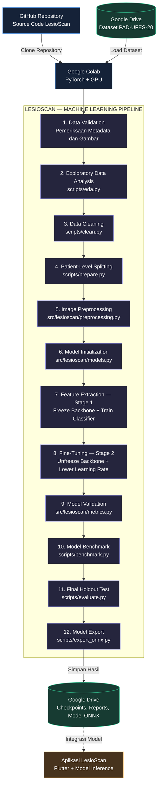

# LesioScan ML

**Klasifikasi citra lesi kulit PAD-UFES-20 menggunakan PyTorch dan Google Colab.**

> **Penelitian dan edukasi saja.** Hasil model bukan diagnosis ataupun alat skrining kanker yang tervalidasi.

## Arsitektur




## Pembagian tanggung jawab

| Komponen | Fungsi |
|---|---|
| GitHub | Menyimpan kode, konfigurasi, dokumentasi dan riwayat perubahan |
| Google Colab | Menjalankan semua proses ML menggunakan Python/PyTorch dan GPU |
| Google Drive | Menyimpan dataset, checkpoint dan file hasil ekspor |

## Mulai di Google Colab

**1.** Aktifkan GPU pada Runtime -> Change runtime type, lalu mount Drive:

```python
from google.colab import drive
drive.mount('/content/drive')
```

**2.** Clone GitHub dan masuk ke direktori proyek:

```python
%cd /content
!git clone https://github.com/Liex2810/lesioscan-ml.git
%cd /content/lesioscan-ml
```

**3.** Periksa Torch (biasanya telah tersedia di Colab), lalu pasang library tambahan jika diperlukan.

```python
import torch
print(torch.__version__, torch.cuda.is_available())
%pip install timm pandas scikit-learn pyyaml matplotlib pillow onnx onnxruntime tqdm pytest
```

**4.** Simpan arsip PAD-UFES-20 ke `MyDrive/LesioScan-AI/datasets/PAD-UFES-20/`. Setelah download selesai, salin/ekstrak gambar ke `data/images/` dan metadata ke `data/metadata.csv` di runtime Colab. **Tahap upload dan ekstraksi belum otomatis pada repository ini.** Pastikan kolom `img_id`, `patient_id`, `diagnostic` tersedia.

**5.** Jalankan pipeline secara berurutan (setelah dataset tersedia):

```bash
python scripts/eda.py
python scripts/clean.py
python scripts/prepare.py
python scripts/train.py --model shufflenet_v2_x1_0
```

Perintah EDA membuat ringkasan dan grafik di `outputs/eda/`. Training otomatis menjalankan **Stage 1 feature extraction** dan **Stage 2 fine-tuning**, kemudian menyimpan `outputs/runs/shufflenet_v2_x1_0/best.pt`. Simpan file hasil penting ke Google Drive sebelum runtime Colab berakhir.

**6.** Jika ingin membandingkan model, gunakan `split.csv` **yang sama** untuk setiap arsitektur:

```bash
python scripts/train.py --model densenet121
python scripts/train.py --model vit_small_patch16_224
```

**7.** Setelah memilih model berdasarkan validasi, lakukan evaluasi holdout satu kali dan ekspor:

```bash
python scripts/evaluate.py --checkpoint outputs/runs/shufflenet_v2_x1_0/best.pt
python scripts/export_onnx.py --checkpoint outputs/runs/shufflenet_v2_x1_0/best.pt
```

## Peta file

| Berkas | Peran |
|---|---|
| `configs/default.yaml` | Parameter dan lokasi data |
| `scripts/eda.py` | Statistik metadata, kelas, pasien, dimensi dan pemeriksaan gambar |
| `scripts/clean.py` | Membersihkan metadata secara konservatif, mengarantina baris bermasalah, dan menghasilkan laporan audit tanpa mengubah data asli |
| `src/lesioscan/cleaning.py` | Pemeriksaan label, ID pasien, duplikasi, keberadaan/kerusakan gambar |
| `scripts/prepare.py` | Membuat `data/split.csv` tanpa pasien yang bocor antarsplit |
| `src/lesioscan/preprocessing.py` | Transformasi train vs validasi/test |
| `src/lesioscan/data.py` | Dataset, DataLoader, patient-level split dan validasi metadata |
| `src/lesioscan/models.py` | ShuffleNet V2, DenseNet-121, ViT-Small |
| `src/lesioscan/feature_extraction.py` | Membekukan backbone untuk Stage 1 |
| `src/lesioscan/fine_tuning.py` | Membuka semua parameter untuk Stage 2 |
| `src/lesioscan/engine.py` | Forward pass, loss, backward, optimizer, validasi |
| `src/lesioscan/metrics.py` | Macro-F1, balanced accuracy, recall per kelas |
| `scripts/train.py` | Mengorkestrasi kedua tahap training dan menyimpan checkpoint |
| `scripts/evaluate.py` | Evaluasi akhir di holdout test |
| `scripts/export_onnx.py` | Ekspor model + pemeriksaan kesetaraan ONNX/PyTorch |

## Batasan saat ini

- **EDA tidak boleh digunakan untuk menyesuaikan keputusan model berdasarkan data test.** Analisis eksplorasi awal boleh mendeskripsikan data keseluruhan; keputusan yang dipelajari dari data menggunakan train saja.
- Split memakai `GroupShuffleSplit`, **belum stratified group split** dan belum 5-fold CV. Periksa kecukupan kelas di setiap split.
- Evaluasi benchmark otomatis, inference gambar baru, dan integrasi Flutter **belum tersedia**.
- Checkpoint masih hanya menyimpan model terpilih, bukan semua keadaan optimizer untuk melanjutkan training dengan presisi.
- Softmax bukan probabilitas medis, dan prediksi pada foto di luar distribusi training tidak bisa diandalkan.

Dataset: https://data.mendeley.com/datasets/zr7vgbcyr2/1


## Persiapan penilaian rubrik

- **Perumusan masalah:** `docs/01_problem_formulation.md`.
- **EDA:** `notebooks/01_exploratory_data_analysis.ipynb` dan `scripts/eda.py`.
- **Split kelas-aware berdasarkan pasien:** `src/lesioscan/splitting.py`, `scripts/prepare.py` (mencari kandidat group split dengan cakupan kelas). Bukan jaminan stratifikasi sempurna.
- **Benchmark:** `python scripts/benchmark.py` (membandingkan **validation metrics**, tidak pernah memilih berdasarkan test).
- **Grafik training:** `python scripts/plot_training.py --history outputs/runs/<run>/history.json`.
- **Grafik evaluasi:** `python scripts/visualize_evaluation.py --metrics outputs/runs/<run>/val_metrics.json`.
- **Inference eksperimen:** `python scripts/predict.py --checkpoint outputs/runs/<run>/best.pt --image <path_gambar>`. **Hanya penelitian, bukan diagnosis.**
- **Benchmark latency:** `python scripts/benchmark_inference.py --checkpoint outputs/runs/<run>/best.pt --device cpu`.
- **Dokumentasi metodologi:** `docs/04_model_evaluation.md`, `docs/05_experiment_protocol.md`, `docs/06_eda_interpretation.md`.

Seluruh script evaluasi dan benchmark memerlukan output training yang **belum tersedia** sebelum dataset diunduh, disiapkan, dan model dilatih.

## Tahap Data Cleaning (sebelum data split)

1. Simpan metadata asli di `data/metadata.csv` dan gambar asli di `data/images/` setelah staging dari Google Drive. Jangan ubah data asli.
2. Jalankan `python scripts/eda.py` untuk melihat karakteristik dan masalah data.
3. Jalankan `python scripts/clean.py`; outputnya `data/metadata_clean.csv`, `outputs/cleaning/cleaning_issues.csv`, dan `outputs/cleaning/cleaning_summary.json`.
4. **Tinjau laporan cleaning**: kolom wajib kosong, label tidak dikenal, konflik image ID, duplikasi, gambar hilang/rusak, dan path tidak aman. Baris bermasalah dikarantina; kode **tidak mengarang label klinis** atau memperbaiki gambar otomatis.
5. Bila temuan sudah ditinjau, jalankan `python scripts/prepare.py`. Script ini membaca **metadata_clean.csv**. Simpan laporan dan split ke Google Drive.

Cleaning *bukan* augmentation maupun normalisasi. Transformasi training (resize, normalisasi ImageNet, augmentation) dilakukan setelah splitting, sehingga tidak menyebabkan kebocoran data. Ambiguitas label memerlukan peninjauan manual berdasarkan sumber terpercaya.
