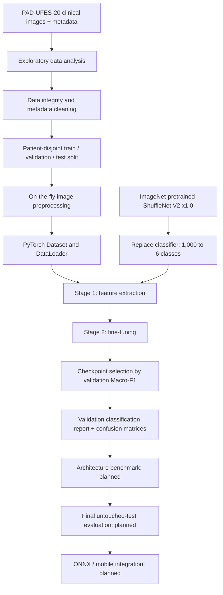

<div align="center">

# LesioScan

### Patient-Aware Skin Lesion Classification · Reproducible Deep Learning · Mobile-Oriented Inference


**A modular machine-learning research project for classifying six types of skin lesions from clinical photographs.**

[Overview](#overview) · [Pipeline](#machine-learning-pipeline) · [Results](#current-experimental-results) · [Usage](#getting-started) · [Limitations](#limitations-and-responsible-use)

</div>

> [!IMPORTANT]
> **Research and educational use only.** LesioScan is **not** a validated diagnostic device. Predictions should not be interpreted as a diagnosis, used to rule out cancer, or replace assessment by a qualified clinician.

## Overview

LesioScan investigates whether an efficient, ImageNet-pretrained **ShuffleNet V2 x1.0** model can distinguish six skin-lesion categories in the **PAD-UFES-20** dataset. The workflow prioritizes patient-disjoint data partitioning, repeatable preprocessing, explicit checkpoint management, and evaluation beyond overall accuracy.

The project separates experiment orchestration (**Jupyter notebooks**), command-line entry points (**`scripts/`**), reusable implementation (**`src/lesioscan/`**), and persistent artifacts (**Google Drive or a local output directory**).

### Classification labels

| Code | Category | Dataset images |
|:---|:---|---:|
| ACK | Actinic keratosis | 730 |
| BCC | Basal cell carcinoma | 845 |
| MEL | Melanoma | 52 |
| NEV | Nevus | 244 |
| SCC | Squamous cell carcinoma | 192 |
| SEK | Seborrheic keratosis | 235 |
| **Total** | | **2,298** |

**Fixed label order:** `ACK → 0`, `BCC → 1`, `MEL → 2`, `NEV → 3`, `SCC → 4`, `SEK → 5`.

The dataset is **highly imbalanced**; in particular, the melanoma class contains only 52 images across the entire dataset. Class-level precision, recall, and F1 are therefore essential.

## Machine-learning pipeline



### Completed phases

| Phase | Description | Status |
|:---|:---|:---:|
| 01 — EDA | Class distribution, missing metadata, examples, image dimensions | ✅ |
| 01 — Cleaning | Metadata validation, image integrity, duplicates, quarantine audit | ✅ |
| 01 — Splitting | Patient-disjoint train/validation/test partition | ✅ |
| 02 — Preprocessing | RGB, resize/pad to 224×224, training-only augmentation, ImageNet normalization | ✅ |
| 03 — Training | ShuffleNet V2 transfer learning: frozen-backbone feature extraction, then fine-tuning | ✅ |
| 04 — Validation | Classification report, confusion matrix, recall, and prediction analysis | ✅ |
| 05 — Multi-model benchmark | DenseNet-121 and ViT-Small comparisons | Planned |
| 06 — Final evaluation | One-time held-out test assessment | Planned |
| Deployment | ONNX export and integration into a mobile app | Planned |

## Project layout

```text
lesioscan-ml/
├── notebooks/
│   ├── 01_exploratory_data_analysis.ipynb
│   ├── 02_preprocessing.ipynb
│   ├── 03_model_training.ipynb
│   └── 04_validation_evaluation.ipynb
├── scripts/
│   ├── eda.py
│   ├── clean.py
│   ├── prepare.py
│   ├── preprocess.py
│   ├── train_lesioscan.py
│   └── evaluate.py
├── src/
│   └── lesioscan/
│       ├── __init__.py
│       ├── data_paths.py
│       ├── eda_pipeline.py
│       ├── cleaning.py
│       ├── splitting.py
│       ├── preprocessing.py
│       ├── dataset.py
│       ├── preprocessing_pipeline.py
│       ├── training.py
│       └── evaluation.py
├── tests/
├── configs/
├── docs/
├── requirements.txt
└── README.md
```

*This layout describes the modules used across the LesioScan workflow. Confirm that newly added notebooks/scripts have been committed before following their paths on a fresh clone.*

### How components connect

```text
Notebook (Colab / Jupyter)
    └── runs scripts/<task>.py
          └── imports src/lesioscan/<task_module>.py
                ├── reads dataset / split metadata
                └── writes reports, figures, checkpoints
```

Notebook files are **orchestrators and experiment records**, not the sole implementation of the algorithms. Shared code is kept in Python modules so experiments can also run from a terminal.

## Data management

The original clinical images are accessed **on demand** rather than writing a second preprocessed-image dataset. The data loader applies transformations when each image is read.

A typical Google Drive workspace is:

```text
MyDrive/LesioScan-AI/
├── datasets/
│   └── PAD-UFES-20/
│       ├── metadata.csv
│       ├── imgs_part_1/
│       └── imgs_part_2/
└── experiments/
    ├── eda/
    ├── cleaning/
    │   └── metadata_clean.csv
    ├── splits/
    │   └── split.csv
    ├── preprocessing/
    └── training/
        └── shufflenet_v2_baseline/
            ├── history.csv
            ├── best_shufflenetv2.pt
            ├── fine_tuning/
            │   ├── history_finetuning.csv
            │   ├── best_finetuning.pt
            │   └── latest_finetuning.pt
            └── validation_evaluation/
                ├── validation_summary.json
                ├── figures/
                └── tables/
```

**Do not commit raw images, patient-level metadata, or model checkpoints to a public repository without verifying data-use permissions and privacy implications.**

### Observed patient-level split

| Partition | Images | Role |
|:---|---:|:---|
| Train | 1,608 | Model parameter updates |
| Validation | 339 | Checkpoint selection and development analysis |
| Test | 351 | Reserved for the final evaluation |
| **Total** | **2,298** | Patient-disjoint partition |

The target was approximately **70% / 15% / 15%**. Exact image proportions differ because splitting is performed at the **patient level**, not by independently shuffling image rows. The held-out test set is intentionally excluded from model development.

## Preprocessing

| Operation | Train | Validation / test |
|:---|:---:|:---:|
| Convert to RGB | ✓ | ✓ |
| Resize/pad to 224 × 224 | ✓ | ✓ |
| Random horizontal/vertical flip | ✓ | — |
| Random rotation (±15°) | ✓ | — |
| Mild color jitter | ✓ | — |
| Convert to tensor | ✓ | ✓ |
| ImageNet normalization | ✓ | ✓ |

- ImageNet mean: `[0.485, 0.456, 0.406]`
- ImageNet standard deviation: `[0.229, 0.224, 0.225]`
- Example DataLoader batch: **`[16, 3, 224, 224]`**
- **Augmentation is training-only.** Validation and test transforms are deterministic.
- Original dataset size remains **2,298 images**; on-the-fly augmentation does not create additional unique cases.

A known follow-up experiment is to revisit dark padding/rotation artifacts, which can add non-clinical visual cues.

## Training methodology

**Model:** `torchvision.models.shufflenet_v2_x1_0`, initialized with ImageNet pretrained weights, with its classification layer replaced by a six-output head.

| Configuration | Stage 1: Feature extraction | Stage 2: Fine-tuning |
|:---|:---|:---|
| Backbone | Frozen | Trainable |
| Classification head | Trainable | Trainable |
| Maximum epochs | 5 | 20 |
| Learning rate | `1e-3` | `3e-5` |
| Optimizer | AdamW | AdamW |
| Weight decay | `1e-4` | `1e-4` |
| Loss | Class-weighted cross-entropy | Class-weighted cross-entropy |
| Checkpoint selection | Validation Macro-F1 | Validation Macro-F1 |

Class weights are calculated **from training data only**. The best Stage 1 checkpoint is used as the starting point for Stage 2.

## Current experimental results

The numbers below are **observed LesioScan validation results**, not held-out test performance or external clinical validation.

### Training progression

| Stage | Epochs run | Best validation Macro-F1 |
|:---|---:|---:|
| Stage 1 — Feature extraction | 5 | **0.3409** |
| Stage 2 — Fine-tuning | 20 | **0.5927** |

The best Stage 1 checkpoint was recorded at **epoch 4**. The Stage 2 best score was around **epoch 15**; the final training epochs showed a widening train–validation loss gap. This suggests possible overfitting and warrants further analysis, rather than treating the final epoch as the best checkpoint.

### Validation classification outcomes

**Validation set:** 339 images. **Correct predictions:** 236. **Accuracy:** approximately **69.62%**. **Best validation Macro-F1:** **0.5927**.

> Macro-F1 is **not** the same as accuracy. Macro-F1 gives equal weight to each of the six classes, regardless of how many images each class contains.

| True class | Correct / total | Recall |
|:---|---:|---:|
| ACK | 85 / 111 | 76.58% |
| BCC | 92 / 124 | 74.19% |
| MEL | 3 / 7 | **42.86%** |
| NEV | 24 / 31 | 77.42% |
| SCC | 4 / 30 | **13.33%** |
| SEK | 28 / 36 | 77.78% |

The current model has **critical limitations for MEL and SCC**:

- **SCC:** 22 of 30 actual SCC images were predicted as **BCC**; only 4 of 30 were recognized as SCC.
- **MEL:** Only 3 of 7 melanoma images were recognized; three were predicted as **SEK** and one as **NEV**.
- The melanoma validation sample is only **seven images**, making its measured recall particularly uncertain.

### Validation confusion matrix (counts)

Rows represent **true labels**; columns represent **predicted labels**.

| True ↓ / Predicted → | ACK | BCC | MEL | NEV | SCC | SEK |
|:---|---:|---:|---:|---:|---:|---:|
| **ACK** | **85** | 15 | 0 | 1 | 3 | 7 |
| **BCC** | 12 | **92** | 1 | 8 | 6 | 5 |
| **MEL** | 0 | 0 | **3** | 1 | 0 | 3 |
| **NEV** | 0 | 2 | 1 | **24** | 0 | 4 |
| **SCC** | 2 | 22 | 0 | 1 | **4** | 1 |
| **SEK** | 2 | 2 | 0 | 4 | 0 | **28** |

These findings are a **baseline for further research**, not evidence of clinical safety or efficacy.

## Getting started

### 1. Clone the repository

```bash
git clone https://github.com/Liex2810/lesioscan-ml.git
cd lesioscan-ml
```

### 2. Create an environment

```bash
python -m venv .venv
```

**Windows PowerShell:**

```powershell
.\.venv\Scripts\Activate.ps1
python -m pip install --upgrade pip
pip install -r requirements.txt
```

**Linux / macOS:**

```bash
source .venv/bin/activate
python -m pip install --upgrade pip
pip install -r requirements.txt
```

Install a **CPU- or CUDA-compatible PyTorch build** as appropriate for your machine. For the supported current commands, see the [official PyTorch installer](https://pytorch.org/get-started/locally/).

### 3. Prepare the dataset and split

Obtain PAD-UFES-20 under the applicable dataset terms. The training pipeline needs:

- The image root containing the dataset's nested image folders.
- `split.csv` produced by the patient-level splitting pipeline, containing `img_id`, `patient_id`, `diagnostic`, and `split`.

### 4. Run the ShuffleNet V2 baseline

```bash
python scripts/train_lesioscan.py \
  --split /path/to/split.csv \
  --images /path/to/PAD-UFES-20 \
  --out /path/to/experiments/training/shufflenet_v2_baseline \
  --epochs-head 5 \
  --epochs-finetune 20 \
  --batch-size 16 \
  --seed 42
```

The command above uses the **two-stage training entry point**. Historical experiments in this repository also used a notebook-based, checkpoint-backed continuation for fine-tuning after a PyTorch checkpoint serialization incompatibility. Avoid overwriting existing checkpoints when rerunning experiments; use a new output directory.

### 5. Run validation evaluation

If `scripts/evaluate.py` and `src/lesioscan/evaluation.py` are present in your checkout:

```bash
python scripts/evaluate.py \
  --split /path/to/split.csv \
  --images /path/to/PAD-UFES-20 \
  --training-out /path/to/experiments/training/shufflenet_v2_baseline \
  --out /path/to/experiments/training/shufflenet_v2_baseline/validation_evaluation \
  --batch-size 16 \
  --trust-own-checkpoint
```

The `--trust-own-checkpoint` option is only appropriate for **checkpoints produced by your own trusted training process**. Some original fine-tuning checkpoints contain NumPy RNG objects that cannot be loaded via restricted weights-only deserialization; unrestricted pickle loading can execute arbitrary code.

**Google Colab:** use the corresponding notebooks, mount Drive, and configure the input/output paths before running. **Do not rerun training notebooks merely to view saved evaluation reports.**

## Benchmarking roadmap

Planned architecture comparisons:

- **ShuffleNet V2 x1.0** — lightweight convolutional baseline.
- **DenseNet-121** — densely connected convolutional baseline.
- **ViT-Small** — transformer-based baseline.

For a meaningful comparison, use a **consistent patient-disjoint evaluation protocol**, same data preprocessing policy, and independently tracked checkpoints. Planned metrics include Macro-F1, balanced accuracy, per-class precision/recall, confusion matrices, model size, and deployment latency measured on a stated device.

### Related research reference

[muhwira27/skin-lesion-cnn-benchmark](https://github.com/muhwira27/skin-lesion-cnn-benchmark) reports a PAD-UFES-20 architecture comparison with **patient-level five-fold cross-validation**. Its reported ShuffleNet V2 Macro-F1 (**0.613 ± 0.026**) is useful as methodological context but is **not directly comparable** to LesioScan's best score on a single validation split.

## Limitations and responsible use

1. **Small and imbalanced dataset:** MEL has only 52 examples overall and seven in the current validation set.
2. **Low recall on high-risk classes:** validation recall is **42.86% for MEL** and **13.33% for SCC**. Incorrectly reassuring predictions are possible.
3. **Single-split development:** validation performance may be sensitive to the selected patients; the final test set remains untouched.
4. **Domain shift:** results on one dataset do not establish reliability across lighting conditions, skin tones, camera devices, populations, or clinical settings.
5. **No clinical validation:** LesioScan is not intended for medical decisions or autonomous screening.

**Do not treat a low-risk predicted category as evidence that a suspicious lesion is benign.** Users with concerning skin changes should seek assessment from a qualified healthcare professional.

## Next steps

- Audit **SCC → BCC** and **MEL → SEK/NEV** classification errors.
- Test controlled class-imbalance strategies and augmentation improvements, one change at a time.
- Benchmark alternative model families under the same patient-aware protocol.
- Run the held-out test evaluation **once** after selecting the final model.
- Export the selected model to ONNX and evaluate runtime behavior and latency in the mobile application.

## Acknowledgments

- **PAD-UFES-20:** clinical skin-lesion dataset used for research. Follow the dataset creators' terms and cite the original dataset publication in any report or paper.
- **PyTorch / torchvision:** pretrained backbones and model training tools.
- **Skin Lesion CNN Benchmark:** methodological inspiration for comparing multiple architectures.

---

<div align="center">

**LesioScan · Built for reproducible experimentation, not medical diagnosis.**

Maintained at [Liex2810/lesioscan-ml](https://github.com/Liex2810/lesioscan-ml)

</div>

