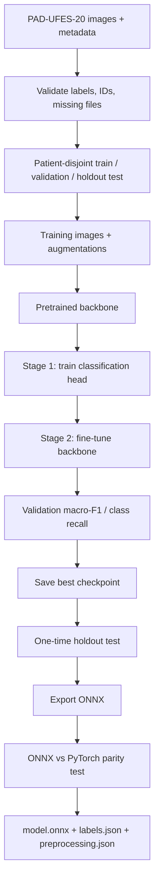

# DermaScan ML — PAD-UFES-20 Research Prototype

A **new, independent** PyTorch repository for patient-disjoint skin-lesion classification using **ShuffleNet V2**, **DenseNet-121**, and **ViT-Small**. Designed to start locally on an **RTX 3060 Laptop GPU (typically 6 GB VRAM)**.

> **Research/education only. NOT a medical diagnosis, screening device, or proof that a lesion is benign.** Performance on new patients is unverified. Report sensitivity for MEL, BCC and SCC; do not deploy for clinical use without external validation and appropriate oversight.

## Architecture



## 0. Install (Windows PowerShell, from repository root)

1. Install Python 3.10/3.11, Git, latest compatible NVIDIA driver.
2. Create venv:

```powershell
py -3.11 -m venv .venv
.\.venv\Scripts\Activate.ps1
python -m pip install --upgrade pip
```

3. Get the correct **CUDA-enabled PyTorch/torchvision** installer from https://pytorch.org/get-started/locally/ and install it; then:

```powershell
pip install -r requirements.txt
python -c "import torch; print(torch.cuda.is_available()); print(torch.cuda.get_device_name(0) if torch.cuda.is_available() else 'CPU')"
pytest -q
```

`requirements.txt` includes PyTorch for environment reproducibility; a previously installed compatible CUDA wheel should be retained. Check CUDA after dependency installation. If `False`, revisit PyTorch installation/driver. CUDA Toolkit is not always required separately for pip wheel use.

## 1. Prepare dataset

Official source: https://data.mendeley.com/datasets/zr7vgbcyr2/1

Place image files in `data/images/` and create `data/metadata.csv` with at least:

```csv
img_id,patient_id,diagnostic
PAT_001_001.png,001,MEL
PAT_002_001.png,002,NEV
```

*Example rows only, not real PAD-UFES-20 filenames.* `img_id` must be an image filename (including extension). Original PAD-UFES-20 metadata uses these key columns, but confirm the actual archive paths. Do not commit patient data or pictures.

```powershell
python scripts/prepare.py
```

Output: `data/split.csv`. It uses patient groups, but `GroupShuffleSplit` is **not stratified by class**, so inspect counts and repeat with another seed if a rare class is absent. If that happens, a better group-stratified split implementation is needed; never use image-level random split to fix it.

## 2. Train (start with one model)

```powershell
python scripts/train.py --model shufflenet_v2_x1_0
```

Other options:

```powershell
python scripts/train.py --model densenet121
python scripts/train.py --model vit_small_patch16_224
```

Results are stored at `outputs/runs/<model>/best.pt`, `history.json`, and `val_metrics.json`. The default batch is **8** to be conservative on a 6 GB RTX 3060. The default Windows-safe number of DataLoader workers is **0**. Increase gradually after a successful smoke test. ViT pretrained weights require download on first run.

**Warning:** Running the same model again overwrites that model's run directory unless you pass `--run my_experiment_name`. Record config/seed for each run.

## 3. Validate and compare

Selection should use validation results (`val_metrics.json`) and especially MEL/BCC/SCC recall. The supplied baseline only implements **one patient-disjoint train/validation/test split**, not the full 5-fold CV research design. Do **not** describe this repository as already doing cross-validation. For a stronger study, add group-aware CV on the development set and reserve a separate holdout test.

## 4. One-time holdout test

After model selection (and freezing the protocol):

```powershell
python scripts/evaluate.py --checkpoint outputs/runs/shufflenet_v2_x1_0/best.pt
```

Output: `test_metrics.json` with macro-F1, balanced accuracy, confusion matrix and per-class recall. The holdout test should not be repeatedly used for tuning.

## 5. Export ONNX

```powershell
python scripts/export_onnx.py --checkpoint outputs/runs/shufflenet_v2_x1_0/best.pt
```

Output:

```text
deployment/
  model.onnx
  labels.json
  preprocessing.json
```

The ONNX graph returns **logits**, not softmax probabilities. Clients must apply softmax and use the exact class order and preprocessing. The script checks ONNX-vs-PyTorch output parity on a random tensor; before shipping, add parity tests using actual validation images and profile device latency/memory.

## Directory map

| Path | Purpose |
| --- | --- |
| `configs/default.yaml` | Experiment parameters, labels, paths |
| `src/dermascan/data.py` | Patient split, transforms, PyTorch Dataset/Dataloader |
| `src/dermascan/models.py` | Three pretrained backbones + 6-class head |
| `src/dermascan/engine.py` | Training/validation loop, AMP, checkpoint metrics |
| `src/dermascan/metrics.py` | Classification metrics |
| `scripts/prepare.py` | Data validation and split creation |
| `scripts/train.py` | Two-stage transfer learning |
| `scripts/evaluate.py` | One-time final test |
| `scripts/export_onnx.py` | ONNX + numerical parity check |
| `tests/` | Automated unit tests |

## Design trade-offs

- **PyTorch over rewriting in TensorFlow:** supports torchvision and timm backbones and stays aligned with the benchmark repository's model family.
- **Patient-level split over random image split:** avoids same-patient leakage.
- **Transfer learning over scratch:** PAD-UFES-20 is small; pretrained image features reduce data demands.
- **Macro-F1 over plain accuracy:** class imbalance can hide rare-lesion failures. Always inspect per-class recall.
- **Head-training then fine-tuning:** adapt new classifier before changing pretrained representations.
- **ONNX over directly bundling Python:** model can run in an optimized non-Python environment; mobile integration is a separate engineering task.

## Limitations / next research steps

- This starter does not yet implement 5-fold cross-validation, Grad-CAM, probabilistic calibration, out-of-distribution rejection, or an external test set. These are recommended **before** asserting generalization or using a model in health-facing software.
- One `GroupShuffleSplit` is not group-stratified; minority classes can be sparse or missing.
- Output accuracy is not established before you run training. Never reuse README scores from another repo as your own.
- Do not treat the six-class softmax maximum as a probability of cancer, nor assume photos outside these six classes can be safely classified.
- Dataset license and clinical claims should be reviewed independently.

Reference inspiration (no code copied): https://github.com/muhwira27/skin-lesion-cnn-benchmark
